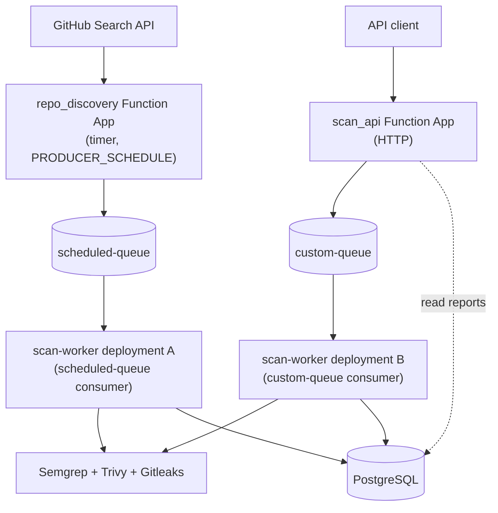

# Vulnscan

Vulnscan is an event-driven vulnerability-scanning pipeline for public GitHub
repositories. It discovers repositories on a schedule and also accepts
user-requested scans over HTTP, publishes each scan as an asynchronous job
through Azure Service Bus, runs the job through Semgrep, Trivy, and Gitleaks
in a worker container, stores the normalized results in PostgreSQL, and
exposes them through an HTTP report-retrieval API.

Originally developed as a course project and subsequently modernized into a
recruiter-facing cloud systems portfolio project. See
[Known limitations](#known-limitations) and
[Project background](#project-background) before drawing conclusions about
production readiness, load behavior, or security guarantees.

## Key engineering highlights

- **Asynchronous producer/worker decoupling.** Both scan paths (scheduled
  discovery and user-initiated HTTP requests) publish a job to Azure Service
  Bus and return immediately instead of blocking on a clone-and-scan that can
  take minutes.
- **Deterministic report identity.** `report_id` is derived entirely from the
  normalized repository address and the exact commit scanned
  (`repo_id = sha256(normalize(owner/repo))[:16]`,
  `report_id = repo_id + commit_id[:16]`), making the ID itself an
  idempotency key.
- **Idempotent database writes, and failures that actually propagate.**
  `ON CONFLICT ... DO UPDATE` / `DO NOTHING` upserts mean a redelivered
  Service Bus message overwrites a row with equivalent data instead of
  creating a duplicate. A failed write rolls back and re-raises rather than
  being logged and swallowed, so a storage failure always triggers Service
  Bus's normal retry behavior instead of the job being reported as
  successful with nothing actually stored.
- **Exact-commit pinning.** Both producers (`scan_api`, `repo_discovery`)
  fetch a repository's HEAD commit exactly once and enqueue a versioned scan
  message (`schema_version`, `repo_addr`, `repo_id`, `commit_id`,
  `report_id`); the worker validates and reuses those exact values instead
  of refetching HEAD itself, closing a race where the repository could move
  between "the producer chose a commit" and "the worker scans a commit."
- **One `scan-worker` container image, deployed to two independent Function
  Apps.** A scan-logic change is maintained in one source tree and needs to
  be built and validated only once before the same image is deployed to both
  Function Apps, while scheduled discovery and user-requested scanning
  remain independently scalable.
- **Bounded subprocess execution.** Every external command (`git`, Semgrep,
  Trivy, Gitleaks) runs through one helper with a mandatory, configurable
  timeout and no shell interpolation.
- **A total scan-job deadline**, independent of and layered on top of
  per-command timeouts, so a sequence of commands cannot together exceed a
  configured budget even if no single command times out.
- **API-key protection before expensive work.** `POST /api/scan/{repo_addr}`
  checks `X-API-Key` with `secrets.compare_digest()` as the first statement
  in its handler, before any repository validation, GitHub call, database
  connection, or queue publish.
- **Scanner output is validated, not trusted blindly.** Empty output,
  invalid JSON, or JSON with the wrong top-level shape from Semgrep, Trivy,
  or Gitleaks raises rather than being treated as a clean, zero-finding
  result -- a broken scanner run can never look identical to "no issues
  found."
- **Infrastructure as code.** All Azure resources (Key Vault, PostgreSQL,
  Service Bus, ACR, four Function Apps) are defined in Bicep templates under
  `iac/`, with secrets delivered as Key Vault references resolved by managed
  identity, never as plaintext app settings.
- **A unit-test suite and CI workflow are present in this repository**
  (`tests/unit/`, `.github/workflows/ci.yml`) -- see
  [Local verification](#local-verification-and-smoke-scripts) for what is
  and is not covered.

## Current architecture

Three source components (plus the shared `shared/` library) are packaged
into three container images and deployed as four independent Azure Function
Apps:

| Source component | Container image | Deployed Function App(s) | Trigger |
|---|---|---|---|
| `repo_discovery/` | `repo-discovery` | one | Timer, controlled by `PRODUCER_SCHEDULE` (current Bicep default: once per minute) |
| `scan_api/` | `scan-api` | one | HTTP (anonymous at the platform level; see [Security and reliability model](#security-and-reliability-model)) |
| `scan_worker/` | `scan-worker` | **two**, one per queue | Service Bus |



**Reading this diagram:** `scan-worker` deployment A and deployment B are the
exact same container image and Python source, deployed twice with a
different `SCAN_QUEUE_NAME` application setting each -- not two separate
codebases. The four boxes in the diagram (`repo_discovery`, `scan_api`, and
the two `scan-worker` deployments) are the four Azure Function Apps this
project deploys. Deployed Azure resource names may retain historical
identifiers (e.g. `scan_api` is deployed as `customized-producer`) that
predate the current source/image naming -- see
docs/design-notes.md for why those were left
unchanged. Key Vault and managed identity are omitted from this diagram for
readability; see [Security and reliability model](#security-and-reliability-model).

An older diagram, `docs/historical-architecture.jpg`, reflects an earlier
naming scheme and is kept for historical reference only -- it is not
maintained and should not be treated as authoritative.

## How a scan moves through the system

**Scheduled discovery:**

```text
repo_discovery (timer trigger, schedule controlled by PRODUCER_SCHEDULE;
                current Bicep default runs once per minute)
  -> GitHub Search API (recently updated repos, >= 10 stars)
  -> dedupe against existing scan_reports
  -> scheduled-queue (Azure Service Bus)
  -> scan-worker (SCAN_QUEUE_NAME=scheduled-queue)
  -> Semgrep + Trivy + Gitleaks
  -> PostgreSQL (repositories, scan_reports)
```

**User-requested scan:**

```text
client
  -> POST /api/scan/{repo_addr}   (scan_api; requires X-API-Key)
  -> custom-queue (Azure Service Bus)
  -> scan-worker (SCAN_QUEUE_NAME=custom-queue)
  -> Semgrep + Trivy + Gitleaks
  -> PostgreSQL (repositories, scan_reports)

client -> GET /api/report/{report_id}       (scan_api, reads PostgreSQL)
client -> GET /api/reports/{repo_addr}      (scan_api, reads PostgreSQL)
client -> GET /api/reports/recent           (scan_api, reads PostgreSQL)
client -> GET /api/report_num               (scan_api, reads PostgreSQL)
```

`POST /api/scan/{repo_addr}` returns immediately (`202 Accepted`) with a
`report_id` and a wait-time estimate; it does not wait for the scan to
finish. The estimate is sourced from GitHub's own repository-size metadata
(`GET /repos/{owner}/{repo}`), not from cloning the repository, and is
explicitly approximate -- it is not a precise prediction, and the response
marks it unavailable (`"estimate_available": false`) rather than failing the
request if that GitHub call does not succeed.

Both flows above enqueue the same versioned message shape
(`shared/messages.py`): the `report_id` returned by the API, or computed by
`repo_discovery`, is exactly the `report_id` the worker later stores --
a scan is pinned to the commit its producer selected, not whatever HEAD
happens to be when the worker picks the message up. A message missing the
expected schema fields (an old, unversioned message, or one with an
inconsistent `repo_id`/`report_id`) is rejected and left to Service Bus's
retry/dead-letter handling rather than being reinterpreted by fetching the
latest HEAD.

## API overview

| Method | Path | Auth | Success | Key error statuses |
|---|---|---|---|---|
| `GET` | `/api/report_num` | Public | `200` with `{"report_num": "<count>"}` | -- |
| `GET` | `/api/reports/recent?limit=20&offset=0` | Public | `200` with a list of `{"report_id", "repo_name", "commit_id"}` | `400` invalid/out-of-range `limit` or `offset` |
| `GET` | `/api/reports/{repo_addr}` | Public | `200` with a list of `{"report_id", "commit_id"}` | `400` malformed `repo_addr` |
| `GET` | `/api/report/{report_id}` | Public | `200` with the full stored report | `404` report not found |
| `POST` | `/api/scan/{repo_addr}` | **`X-API-Key` required** | `202` (new scan queued) or `200` (exact commit already scanned) | `400` malformed `repo_addr` or unreachable repository; `401` missing/invalid key; `503` server has no `SCAN_API_KEY` configured |

`repo_addr` is case-insensitive (`Pallets/Flask` and `pallets/flask` resolve
to the same repository); every route rejects anything that isn't exactly one
`owner/repo` pair. Any unexpected server-side failure on any route returns a
generic `500 {"error": "Internal server error"}` -- never exception detail,
a stack trace, or a backend-specific error message.

### Scan-submission request

```bash
curl -X POST "$VULNSCAN_BASE_URL/api/scan/pallets/flask" \
  -H "X-API-Key: $VULNSCAN_API_KEY"
```

A successful `202` response looks like:

```json
{"report_id": "...", "estimate_wait_time(s)": 187, "estimate_available": true}
```

An already-scanned commit returns `200` with `"estimate_wait_time(s)": 0`
instead. See [Security and reliability model](#security-and-reliability-model)
for the full `401`/`503` behavior.

## Repository structure

```text
vulnscan/
├── shared/                  # library imported by all four Function Apps
│   ├── db.py                 # PostgreSQL access (psycopg2)
│   ├── job.py                 # orchestrates one scan end to end
│   ├── scanner.py             # runs Semgrep/Trivy/Gitleaks with bounded timeouts
│   ├── procrun.py              # bounded external-command execution helper
│   ├── github_client.py        # GitHub REST API access (auth, timeouts, errors)
│   ├── stats.py                 # summarizes scan results into counts
│   └── utils.py                 # repo-address normalization, hashing, git HEAD lookup
├── repo_discovery/            # timer trigger: repo discovery
├── scan_api/                  # HTTP trigger: the public REST API
│   └── scan_api/                # routing.py, handlers.py, responses.py, auth.py
├── scan_worker/              # Service Bus trigger: shared scan logic, deployed twice
├── db/
│   ├── migrations/            # numbered schema history (001, 002, 003, ...)
│   └── README.md               # how to initialize a database
├── iac/                      # Bicep templates for all Azure resources
├── tests/unit/                # pytest suite (no live services required)
├── scripts/
│   ├── push_to_acr.sh          # build + push one of the three images to ACR
│   └── smoke/                  # manual live-endpoint verification scripts
├── docs/
│   ├── design-notes.md          # architecture rationale and tradeoffs
│   ├── security-model.md        # trust boundaries, controls, residual risks
│   ├── deployment.md            # full deployment procedure
│   └── historical-architecture.jpg  # earlier diagram, kept for reference only
└── .env.example               # required/optional environment variables
```

## Security and reliability model

Full detail lives in docs/security-model.md; the
short version:

- **`POST /api/scan/{repo_addr}` requires an `X-API-Key` header**, checked
  with `secrets.compare_digest()` against the server's `SCAN_API_KEY`. A
  missing key and an incorrect key return the identical `401`. An unset or
  empty `SCAN_API_KEY` fails closed with `503` rather than accepting the
  request unauthenticated. The check runs before any repository validation,
  GitHub call, database connection, or queue publish.
- **The four `GET` routes stay public** and never require a key.
- **This is API-key protection for one endpoint, not a general authorization
  system.** There is no user-account system, no OAuth, no per-caller
  identity, and no rate limiting -- a valid key grants unlimited scan
  submissions.
- **Duplicate compute is possible; duplicate data is not.** Idempotent
  database writes prevent duplicate *rows* from a redelivered Service Bus
  message, but two workers can still both clone and scan the same commit
  concurrently before either writes -- wasted compute, not a correctness
  bug.
- **Command timeouts and the total job deadline reduce, but do not
  eliminate, Service Bus message-lock expiration risk.** Message-lock
  auto-renewal is not implemented; see
  docs/design-notes.md.
- **Scanners run inside the worker container against untrusted repository
  content**, with no per-scan sandbox boundary. See
  docs/security-model.md for the full list of
  residual risks (container root user, unpinned Trivy install path, tag- vs.
  digest-pinned base images, and more).
- **Public reports contain sanitized Gitleaks metadata, not discovered
  secret values.** Gitleaks findings are stripped down to an allowlist of
  safe diagnostic fields (file, line numbers, rule ID, fingerprint) before
  they are stored or returned by `GET /api/report/{report_id}` -- fields
  that can carry the literal detected credential (`Secret`, `Match`,
  `Line`) are removed. This is a specific, targeted mitigation, not a
  general data-loss-prevention system; see
  docs/security-model.md.
- **No deterministic infrastructure credentials.** The PostgreSQL
  administrator password is a required, `@secure()`-marked Bicep parameter
  generated outside the repository, not a value derived from
  `resourceGroup().id`; the Azure Container Registry admin account is
  disabled, since every consumer of the registry already authenticates with
  an Azure identity (managed identity or the caller's own `az` login).

## Local verification and smoke scripts

### Running the unit tests

```bash
python -m pip install -r requirements-dev.txt
python -m pytest
```

The unit test suite requires no Azure, GitHub, PostgreSQL, Docker, Semgrep,
Trivy, or Gitleaks -- external systems are mocked. It covers repository
address normalization, bounded subprocess execution, the GitHub client, the
scanner pipeline's timeout/error handling, the scan-worker message
contract, and the HTTP API's routing, error responses, and authentication
behavior. Coverage is unit-level, not exhaustive -- see `tests/unit/` for
what is actually covered.

### Smoke-testing a live deployment

`scripts/smoke/` contains manual scripts that hit a real deployed API over
HTTP. They are not part of the automated test suite, are never run by CI,
and have not been executed against a live deployment as part of this
modernization pass. See scripts/smoke/README.md
for usage; in short:

```bash
export VULNSCAN_BASE_URL=https://<your-function-app>.azurewebsites.net
python3 scripts/smoke/check_report_num.py
```

`scan_and_fetch_report.py` additionally requires `VULNSCAN_API_KEY`, since it
exercises `POST /api/scan/{repo_addr}`.

## Deployment overview

Vulnscan deploys as four Azure Function Apps built from three container
images (`repo-discovery`, `scan-api`, `scan-worker` -- with `scan-worker`
built once and deployed twice), provisioned via the Bicep templates in
`iac/` and backed by Key Vault-managed secrets. See
docs/deployment.md for the full procedure: prerequisite
tools, resource list, Bicep and migration ordering, required environment
variables and Key Vault secret names, and image-tagging conventions.

**Statically reviewed; not validated against a live Azure deployment in this
modernization pass.** No image has been built, no Bicep template has been
compiled, and no deployment has been attempted as part of preparing this
repository.

## Known limitations

This project has not been re-verified against a live Azure deployment.
Specifically, not yet true or not yet verified:

- **No load testing.** Nothing here claims a particular throughput or
  latency.
- **No security isolation for the scan sandbox.** Scans run as subprocesses
  inside the worker container, cloning and executing tooling against
  arbitrary public repositories; there is no per-scan container or VM
  boundary. See docs/security-model.md.
- **No CI-verified live deployment.** CI runs the unit test suite and a
  byte-compilation check only; it does not deploy or exercise a real Azure
  environment.
- **No automatic database migration runner.** `db/migrations/` is a plain,
  manually-applied SQL history (see `db/README.md`).
- **Not backward-compatible with pre-existing mixed-case repository data.**
  Repository address normalization (lowercasing before hashing) is a
  one-time breaking change for any database populated before normalization
  existed: see
  docs/design-notes.md's "Repository ID compatibility"
  section. This project expects initialization from a clean database.
- **Test coverage is unit-level, not exhaustive** -- see `tests/unit/` for
  what is actually covered.
- **API-key authentication is not full authorization.** A single shared
  `SCAN_API_KEY` gates scan submission; there are no user accounts, no
  OAuth, no per-caller rate limiting, and no revocation short of rotating
  the one key. See docs/security-model.md.
- **Duplicate compute vs. duplicate data are different things.** See
  [Security and reliability model](#security-and-reliability-model) above.
- **Message-lock renewal is not implemented.** Per-command timeouts and the
  total job deadline reduce, but do not eliminate, Service Bus message-lock
  expiration risk -- see
  docs/design-notes.md.
- **Old, unversioned queue messages are not supported.** The worker only
  accepts the current `schema_version` of the scan-message contract
  (`shared/messages.py`); a message from an earlier, unversioned producer
  is rejected and dead-lettered rather than reinterpreted. This project
  expects a clean deployment with no in-flight legacy messages, not a
  rolling migration of an existing queue.

## Project background

Vulnscan originated as a course project and was subsequently modernized into
this recruiter-facing form: repository-address normalization, bounded
subprocess execution with a total job deadline, a shared GitHub API client,
consolidated scan-worker source (one image instead of two near-duplicate
ones), domain-oriented source/image naming, an internally restructured HTTP
API, and API-key protection for scan submission were all added or
substantially reworked during that process. See
docs/design-notes.md for the reasoning behind
current design decisions and a list of work intentionally deferred past this
pass.

---

*This page reproduces the project's README. The source files and supporting documents it mentions are kept in a private source archive and are available on request.*
